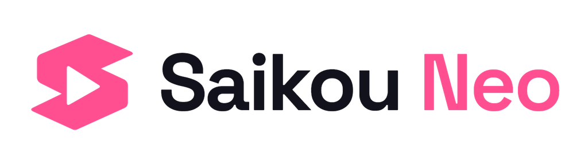

<!-- markdownlint-disable MD033 -->

# Saikou Neo

  <picture>
    <source media="(prefers-color-scheme: dark)" srcset=".github/assets/saikou-neo-dark.png">
    
  </picture>
  
<strong>Anime, made for your TV.</strong> Native interfaces. Shared Kotlin Multiplatform core.

  

    
    
    
  

  

    
    
    
  

Saikou Neo is an anime-focused TV app built around remote-friendly browsing,
native playback and optional AniList or MyAnimeList tracking. Android TV and
Android-based Fire TV come first, alongside an Android companion for sign-in
and secure TV pairing.

> [!IMPORTANT]
> **Early Alpha. No public app release yet.** The app implementation and test
> builds remain local; this public repository currently contains the workflow
> scaffold and project branding. Full source and downloadable builds are not
> published yet.

## Where we're at

| Stage | Progress |
| :--- | :--- |
| **Foundation · complete** | Shared core, native TV/companion shells, controlled sample playback, resume and local build checks. |
| **Alpha · working locally** | AniList/MAL sign-in and QR/code TV pairing; adaptive companion layouts. MAL lifecycle verification still has outstanding checks. |
| **Alpha · next** | Provider Library and tracking, real catalogue data, extensions, production playback and the accepted native TV design. |
| **Later** | iPhone companion and Apple TV, sharing core logic with native UIs. |

Local test results are separate from release readiness. The
**[Alpha work view](https://github.com/users/kemuriXD/projects/1/views/7)** tracks
the remaining work; the **[full roadmap](https://github.com/users/kemuriXD/projects/1)**
also covers release checks and later platforms.

## The direction

- **TV first:** Home, Discover, search, series details and episodes designed for a remote.
- **Your lists:** optional AniList or MyAnimeList Library and automatic tracking.
- **Your playback:** source/quality selection, audio and subtitle preferences, and resume.
- **Extend Neo:** separately installed source and watch-order extensions, with no playback sources bundled.

These are the planned product capabilities; their implementation status lives
on the roadmap. Designs may evolve as we test them on real devices.

## Follow along

Watch the repository for updates, explore the **[roadmap](https://github.com/users/kemuriXD/projects/1)**,
or check **[existing issues](https://github.com/kemuriXD/saikou-neo/issues)** before
reporting an important bug or blocker.

---

  
<strong>Thanks for stopping by!</strong>

  
  
Approximate visits · <a href="https://github.com/journey-ad/Moe-Counter">Moe Counter</a>

